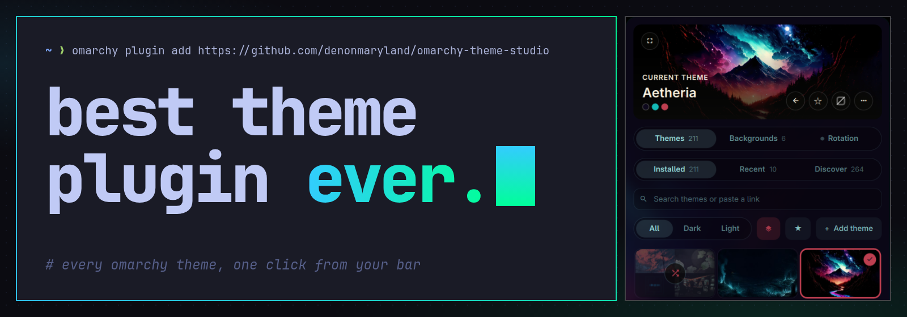
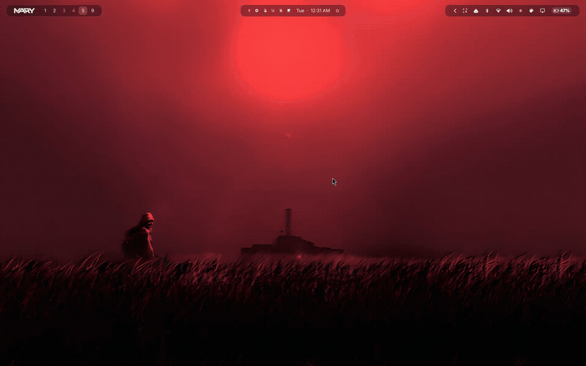
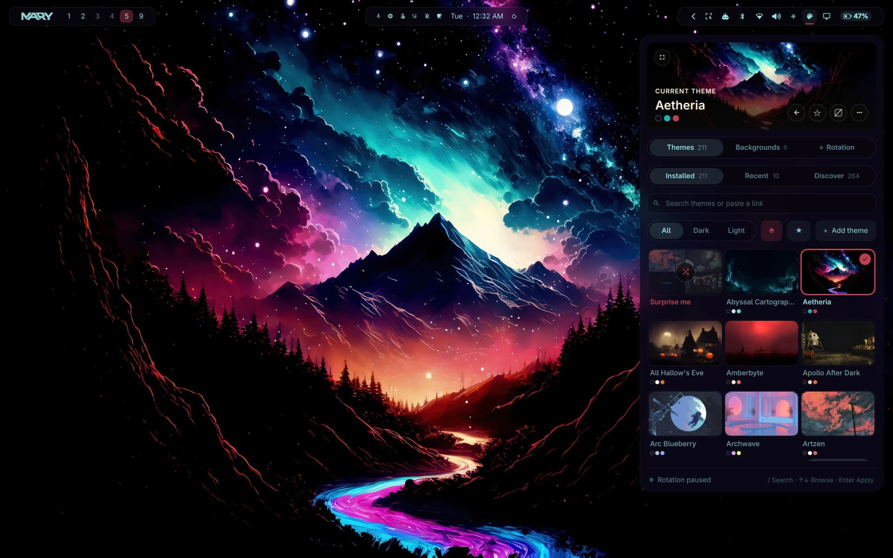
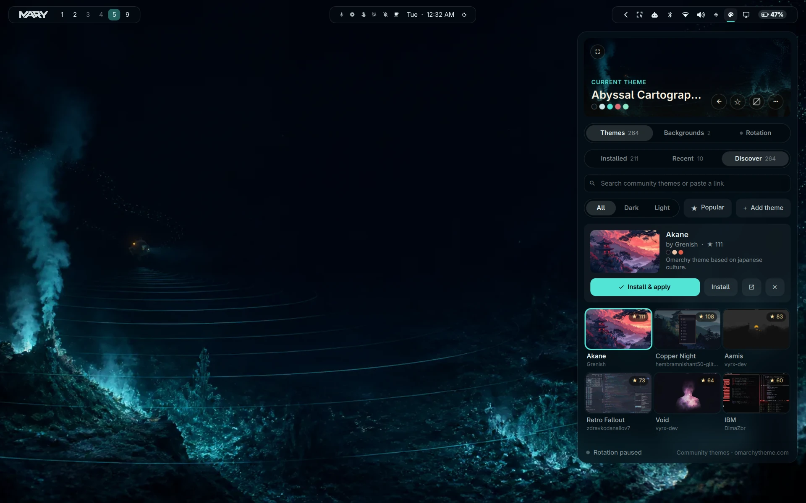
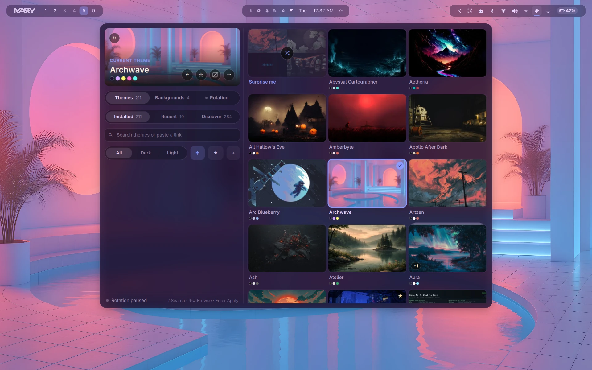

<p align="center">
  
</p>

<p align="center">
  <b>A theme panel for the <a href="https://omarchy.org">Omarchy</a> bar.</b><br>
  Browse and apply themes instantly, discover community themes, install from any link,<br>
  rotate on a timer or with the sun, and pick wallpapers and border colors per theme.
</p>

<p align="center">
  <a href="#install"></a>
  
  <a href="LICENSE"></a>
</p>



<sub>Recorded on Omarchy with the optional denon.bar glass bar. On the stock bar the same panel opens in Omarchy's standard popup.</sub>

## Install

```bash
omarchy plugin add https://github.com/denonmaryland/omarchy-theme-studio --enable
```

Then click the palette icon in the bar.

## A look around

<table>
  <tr>
    <td width="50%"></td>
    <td width="50%"></td>
  </tr>
  <tr>
    <td><b>Compact panel.</b> Opens from the bar. Click a theme and the whole desktop follows; the last click always wins.</td>
    <td><b>Discover.</b> 260+ community themes, or paste any link: a GitHub repo, an archive, a theme page, an image.</td>
  </tr>
  <tr>
    <td colspan="2"></td>
  </tr>
  <tr>
    <td colspan="2"><b>Wide window.</b> Press <code>E</code> for a bigger gallery with the controls alongside.</td>
  </tr>
</table>

## Features

- **Instant switching.** The panel updates the moment you click, and rapid clicking never gets stuck.
- **Installed · Recent · Discover.** Light/dark filters, favorites, search, and lookalike grouping
  (near-identical themes stack into one tile).
- **Back button.** Step back through your last 10 themes, each with the wallpaper you last used with it.
- **Install from a link.** GitHub repos, theme pages, zip/tar archives, images or a local folder.
  Images become a full generated theme, with six palette styles to choose from.
- **Rotation.** A new theme every 15, 30 or 60 minutes, with Keep / Maybe / Not for me to tune the mix.
  **Follow the sun** switches to light themes at sunrise and dark at sunset, computed locally.
- **Wallpapers.** Pick between a theme's wallpapers, shuffle them, or find openly licensed images
  on Openverse. Credits are saved next to each download.
- **Window borders.** Pick a border color from the theme's palette, or turn borders off for every theme.

| Key | Action | Key | Action |
|---|---|---|---|
| `/` | Search | `B` | Back |
| arrows | Browse | `E` | Expand / compact |
| `Enter` | Apply | `F` | Favorite |
| `1` `2` `3` | Tabs | `Esc` | Close |

## Remove

1. If you turned on window border colors, first open Best Theme Plugin Ever and choose
   **⋯ → Remove system changes**. That removes the one line and file it added
   (see below).
2. Remove the plugin:

   ```bash
   omarchy plugin remove io.github.denonmaryland.theme-studio
   ```

3. Optional: delete its saved settings and caches.

   ```bash
   rm -rf ~/.local/state/omarchy-theme-studio ~/.cache/omarchy-theme-studio
   ```

Themes and wallpapers you installed through Best Theme Plugin Ever are normal Omarchy
themes and stay installed. Remove them in the panel (⋯ → Delete theme) or with
`omarchy theme remove`.

## Requirements

Omarchy with the shell bar, which includes Python 3 and ImageMagick. `git`
is needed for repository installs. Window border colors need Omarchy's Lua
Hyprland config (`~/.config/hypr/hyprland.lua`).

If the `denon.bar` glass bar plugin is installed, Best Theme Plugin Ever uses its
animated panel host (hover to preview, click to keep). Otherwise it uses
Omarchy's standard popup.

<details>
<summary><b>What it changes on your system</b></summary>

Best Theme Plugin Ever runs inside the Omarchy shell. It doesn't install services or
hooks, and it doesn't need root.

| What | When |
|---|---|
| Applies themes and wallpapers with `omarchy theme set` / `omarchy theme bg set` | When you pick one, or when rotation / Follow the sun is on |
| Installs themes into `~/.config/omarchy/themes/` | Only when you install one |
| Saves wallpapers into the current theme's background folder, with `CREDITS.md` | Only when you save one |
| Adds `~/.config/hypr/theme_studio_border.lua` and one marked `require` line at the end of `~/.config/hypr/hyprland.lua` | Only after you press **Allow** in the window border picker. **⋯ → Remove system changes** removes both. |
| Settings and history in `~/.local/state/omarchy-theme-studio/`; thumbnails and downloads in `~/.cache/omarchy-theme-studio/` | Always |

</details>

<details>
<summary><b>Network use</b></summary>

- **Discover** reads a community theme catalog and fetches preview images.
- **Find more** (wallpapers) searches the Openverse API.
- Installs from a link download from the address you paste.

There's no telemetry and no account.

</details>

<details>
<summary><b>Security notes</b></summary>

Themes you install are code-adjacent: Omarchy can load a theme's `hyprland.lua`,
`neovim.lua` and terminal configs. Omarchy itself refuses those files from themes
that keep their `.git` folder. Best Theme Plugin Ever applies the same rule to every theme
it installs without `.git` (archives, web pages, repository subfolders, folders):

- `*.lua`, `alacritty.toml`, `foot.ini`, `ghostty.conf`, `kitty.conf` and
  `vscode.json` are removed, along with any symlinks.
- Git installs are shallow clones with symlinks disabled (also for later
  updates) and no submodules. The installed commit is recorded.
- Updates are pulled and checked in a temporary copy before replacing an
  installed theme. Failed pulls or updates missing a theme definition leave
  the existing installation intact; successful updates preserve local files.
- Older themes that only provide `alacritty.toml` have their palette converted
  to `colors.toml` before the terminal config is removed.
- Downloads are http(s) only, with size limits. Archives are checked for unsafe
  paths, total unpacked size (1 GiB) and file count (5000).

Repository installs fetch the repository's current version, which is whatever
its author has published. Only install themes you trust.

</details>

<details>
<summary><b>Development checks</b></summary>

```bash
python3 -m unittest discover -s tests -v
node --test tests/theme_queue.cjs
omarchy plugin validate .
```

The importer checks use temporary folders and local Git repositories. Legacy
palette coverage needs Omarchy's `omarchy-theme-colors-from-alacritty` command.
The Node.js checks exercise the QML switching functions without a desktop;
they do not replace a live mouse walkthrough or short-screen layout checks.

Release preparation and outstanding live checks are tracked in
[the marketplace checklist](docs/RELEASE-CHECKLIST.md).

</details>

## License

MIT. Themes and wallpapers shown in the screenshots belong to their creators.
