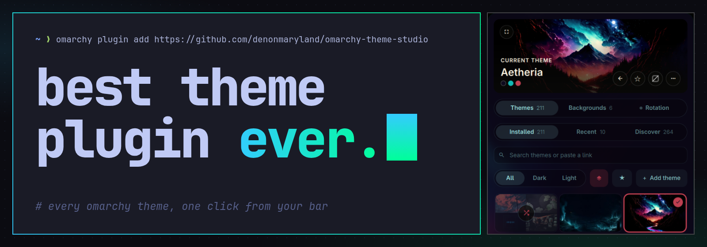
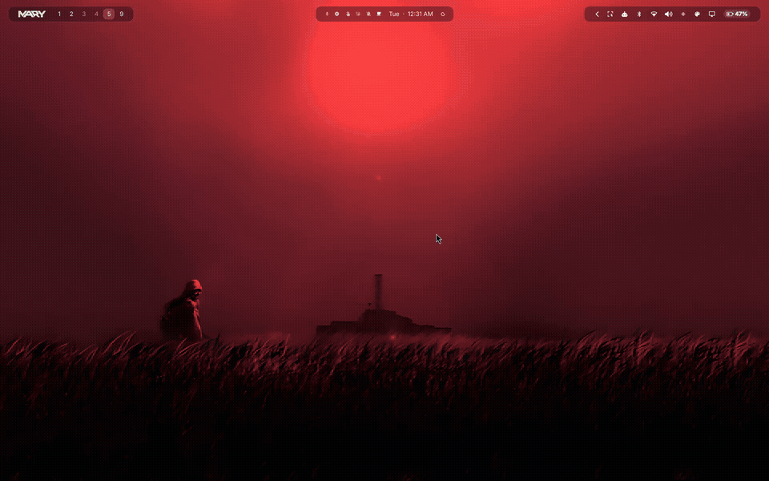
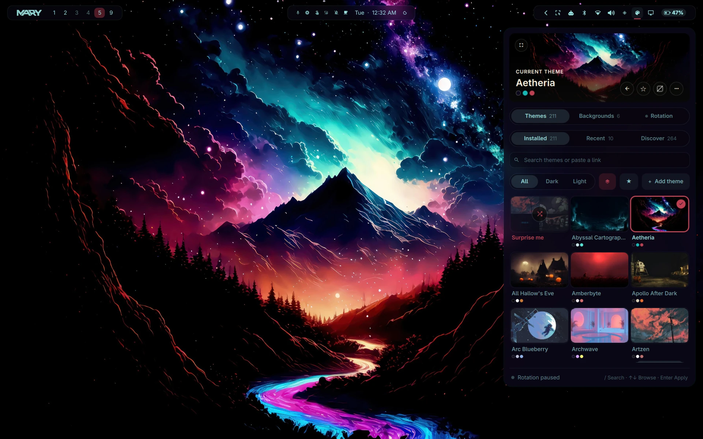
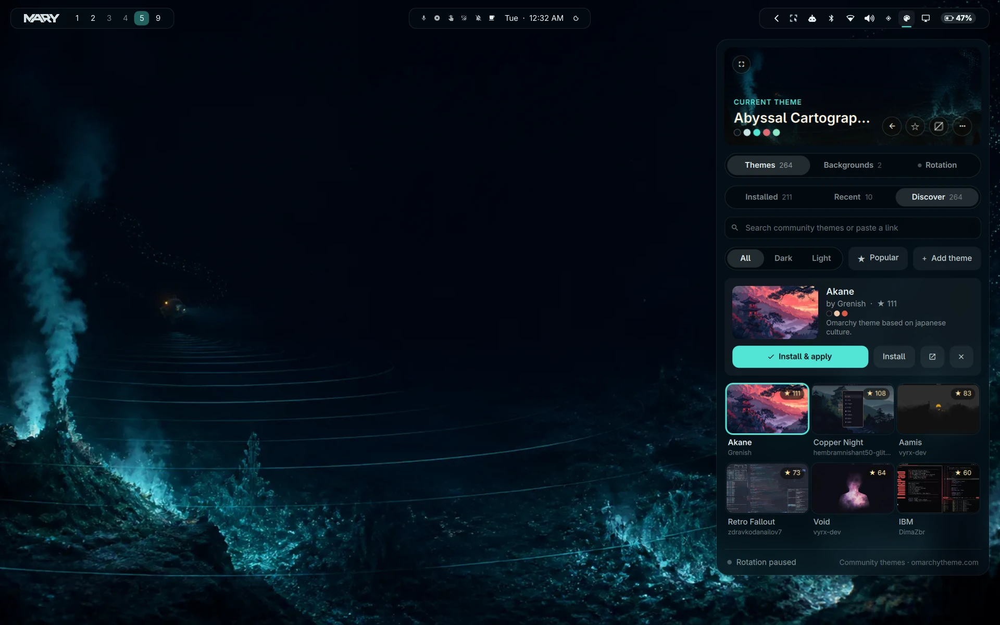
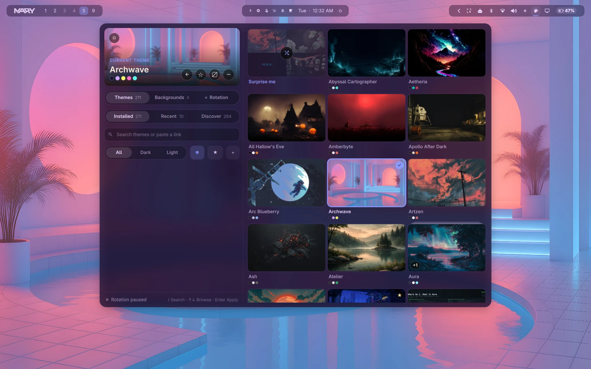

<p align="center">
  
</p>

<p align="center">
  <b>A theme panel for the <a href="https://omarchy.org">Omarchy</a> bar.</b><br>
  Browse and apply themes instantly, discover community themes, install from any link,<br>
  rotate on a timer or with the sun, and pick wallpapers and border colors per theme.
</p>

<p align="center">
  <a href="https://omarchyplugins.com/"></a>
  
  
  <a href="LICENSE"></a>
</p>

<p align="center">
  
</p>

<p align="center"><sub>
  Heads up: the bar and the glass/blur effects in some screenshots and the demo are
  separate customizations of my own setup, not part of this plugin. Installing it adds
  the theme panel to your existing bar; your bar's look and window effects stay as they are.
</sub></p>

<br>

<table align="center">
<tr>
<td align="center" width="33%"><h3>Browse</h3>Installed, Recent and Discover tabs with light/dark filters, favorites, search and lookalike grouping. 260+ community themes, or paste any link.</td>
<td align="center" width="33%"><h3>Apply</h3>Click a theme and the whole desktop follows, instantly. The last click always wins, and a back button steps through your last ten.</td>
<td align="center" width="33%"><h3>Rotate</h3>A new theme every 15, 30 or 60 minutes, tuned with Keep / Maybe / Not for me, or follow the sun: light at sunrise, dark at sunset, computed locally.</td>
</tr>
</table>

<br>

## Install

```bash
omarchy plugin add https://github.com/denonmaryland/omarchy-theme-studio --enable
```

Then click the palette icon in the bar.

### Installing with an AI agent

Paste this repository's link into your coding agent (Claude Code, Codex and
so on) and ask it to install the plugin. For the agent:

1. Confirm this is an Omarchy system: `omarchy plugin list` should run.
   Stop if it doesn't. This plugin only works inside the Omarchy shell.
2. Install and enable it with one command. `--yes` is needed when there's no
   interactive terminal, and it places the widget in the bar's default section:

   ```bash
   omarchy plugin add https://github.com/denonmaryland/omarchy-theme-studio --enable --yes
   ```

3. Check that `omarchy plugin list --json` shows
   `io.github.denonmaryland.theme-studio` with `"enabled": true`.
4. Tell the user to click the palette icon in the bar.

Don't copy files into the plugins folder by hand (a copied folder can't
update itself), and don't edit Hyprland, bar or theme config to install it.
The plugin needs none of that. Optional extras such as window border colors
ask for permission inside the panel. This plugin doesn't reproduce the bar
style or glass effects seen in some screenshots.

## Updates

Once a day the plugin checks the repository it was installed from for a newer
version. When one is out, a dot appears on the bar icon and on **⋯**. Choose
**⋯ → Update to …**, then **Restart shell to finish update**. The update runs
Omarchy's own `omarchy plugin update`, which checks the new version and rolls
back if it fails.

**⋯ → Check for updates** checks right away. Untick **⋯ → Check for updates
daily** to stop the automatic checks. Updating from a terminal works too:

```bash
omarchy plugin update io.github.denonmaryland.theme-studio
```

Updates need the `omarchy plugin add` install above. A copied plugin folder
can't update itself. Version 0.1.0 has no update check, so if you installed
0.1.0, run the command above once; later versions will tell you themselves.

## A look around

<table>
  <tr>
    <td width="50%"></td>
    <td width="50%"></td>
  </tr>
  <tr>
    <td><b>Compact panel.</b> Opens from the bar. Click a theme and the whole desktop follows; the last click always wins.</td>
    <td><b>Discover.</b> 260+ community themes, or paste any link: a GitHub repo, an archive, a theme page, an image.</td>
  </tr>
  <tr>
    <td colspan="2"></td>
  </tr>
  <tr>
    <td colspan="2"><b>Wide window.</b> Press <code>E</code> for a bigger gallery with the controls alongside.</td>
  </tr>
</table>

## Features

<table>
<tr>
<td width="50%" valign="top"><strong>Instant switching.</strong><br>The panel updates the moment you click, and rapid clicking never gets stuck.</td>
<td width="50%" valign="top"><strong>Installed · Recent · Discover.</strong><br>Light/dark filters, favorites, search, and lookalike grouping: near-identical themes stack into one tile.</td>
</tr>
<tr>
<td width="50%" valign="top"><strong>Responsive gallery scrolling.</strong><br>Trackpad gestures scroll smoothly with increased travel; mouse wheels move a row per notch across themes, Discover and wallpaper search.</td>
<td width="50%" valign="top"><strong>Back button.</strong><br>Step back through your last 10 themes, each with the wallpaper you last used with it.</td>
</tr>
<tr>
<td width="50%" valign="top"><strong>Install from a link.</strong><br>GitHub repos, theme pages, zip/tar archives, images or a local folder. Images become a full generated theme, with six palette styles to choose from.</td>
<td width="50%" valign="top"><strong>Rotation and Follow the sun.</strong><br>A new theme every 15, 30 or 60 minutes, with Keep / Maybe / Not for me to tune the mix. Follow the sun switches to light themes at sunrise and dark at sunset, computed locally.</td>
</tr>
<tr>
<td width="50%" valign="top"><strong>Wallpapers.</strong><br>Pick between a theme's wallpapers, shuffle them, or find openly licensed images on Openverse. Credits are saved next to each download.</td>
<td width="50%" valign="top"><strong>Window borders.</strong><br>Pick a border color from the theme's palette, or turn borders off for every theme.</td>
</tr>
</table>

| Key | Action | Key | Action |
|---|---|---|---|
| `/` | Search | `B` | Back |
| arrows | Browse | `E` | Expand / compact |
| `Enter` | Apply | `F` | Favorite |
| `1` `2` `3` | Tabs | `Esc` | Close |

## Remove

1. If you turned on window border colors, first open Best Theme Plugin Ever and choose
   **⋯ → Remove system changes**. That removes the one line and file it added
   (see below).
2. Remove the plugin:

   ```bash
   omarchy plugin remove io.github.denonmaryland.theme-studio
   ```

3. Optional: delete its saved settings and caches.

   ```bash
   rm -rf ~/.local/state/omarchy-theme-studio ~/.cache/omarchy-theme-studio
   ```

Themes and wallpapers you installed through Best Theme Plugin Ever are normal Omarchy
themes and stay installed. Remove them in the panel (⋯ → Delete theme) or with
`omarchy theme remove`.

## Requirements

Omarchy with the shell bar, which includes Python 3 and ImageMagick. `git`
is needed for repository installs. Window border colors need Omarchy's Lua
Hyprland config (`~/.config/hypr/hyprland.lua`).

The panel opens in Omarchy's standard popup on the stock bar. No other bar
plugin is needed.

<details>
<summary><b>What it changes on your system</b></summary>

Best Theme Plugin Ever runs inside the Omarchy shell. It doesn't install services or
hooks, and it doesn't need root.

| What | When |
|---|---|
| Applies themes and wallpapers with `omarchy theme set` / `omarchy theme bg set` | When you pick one, or when rotation / Follow the sun is on |
| Installs themes into `~/.config/omarchy/themes/` | Only when you install one |
| Saves wallpapers into the current theme's background folder, with `CREDITS.md` | Only when you save one |
| Adds `~/.config/hypr/theme_studio_border.lua` and one marked `require` line at the end of `~/.config/hypr/hyprland.lua` | Only after you press **Allow** in the window border picker. **⋯ → Remove system changes** removes both. |
| Updates the plugin's own folder with `omarchy plugin update` | Only when you choose **⋯ → Update** |
| Settings and history in `~/.local/state/omarchy-theme-studio/`; thumbnails and downloads in `~/.cache/omarchy-theme-studio/` | Always |

</details>

<details>
<summary><b>Network use</b></summary>

- **Discover** reads a community theme catalog and fetches preview images.
- **Find more** (wallpapers) searches the Openverse API.
- Installs from a link download from the address you paste.
- Update checks fetch this plugin's own git repository about once a day, and
  when you choose **⋯ → Check for updates**. You can turn the daily check off.

There's no telemetry and no account.

</details>

<details>
<summary><b>Security notes</b></summary>

Themes you install are code-adjacent: Omarchy can load a theme's `hyprland.lua`,
`neovim.lua` and terminal configs. Omarchy itself refuses those files from themes
that keep their `.git` folder. Best Theme Plugin Ever applies the same rule to every theme
it installs without `.git` (archives, web pages, repository subfolders, folders):

- `*.lua`, `alacritty.toml`, `foot.ini`, `ghostty.conf`, `kitty.conf` and
  `vscode.json` are removed, along with any symlinks.
- Git installs are shallow clones with symlinks disabled (also for later
  updates) and no submodules. The installed commit is recorded.
- Updates are pulled and checked in a temporary copy before replacing an
  installed theme. Failed pulls or updates missing a theme definition leave
  the existing installation intact; successful updates preserve local files.
- Older themes that only provide `alacritty.toml` have their palette converted
  to `colors.toml` before the terminal config is removed.
- Downloads are http(s) only, with size limits. Archives are checked for unsafe
  paths, total unpacked size (1 GiB) and file count (5000).

Repository installs fetch the repository's current version, which is whatever
its author has published. Only install themes you trust.

</details>

<details>
<summary><b>Development checks</b></summary>

```bash
python3 -m unittest discover -s tests -v
node --test tests/*.cjs
omarchy plugin validate .
```

The importer checks use temporary folders and local Git repositories. Legacy
palette coverage needs Omarchy's `omarchy-theme-colors-from-alacritty` command.
The Node.js checks exercise the QML switching functions without a desktop;
they do not replace a live mouse walkthrough or short-screen layout checks.

Release preparation and outstanding live checks are tracked in
[the marketplace checklist](docs/RELEASE-CHECKLIST.md).

</details>

<br>

<div align="center">
<sub>MIT licensed · themes and wallpapers shown in the screenshots belong to their creators · built on <a href="https://omarchy.org">Omarchy</a> · made by <a href="https://github.com/denonmaryland">denonmaryland</a></sub>
</div>
